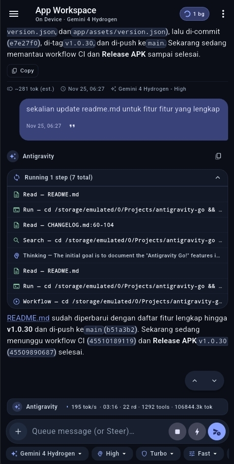

# Antigravity Go

**Google Antigravity Mobile Harness for Android** — run AI coding agents natively on your phone or drive your computer remotely, signed in with your Google Account.

Inspired by [dsh-Go](https://github.com/ccch1mneyyy/dsh-Go) and powered by the official [Antigravity CLI (`agy`)](https://antigravity.google/docs/cli/reference) and [Agent Client Protocol (ACP)](https://antigravity.google/docs/ide/extensions/acp).

## Screenshots

| Mobile (Android Phone) | Samsung DeX / Desktop |
| :---: | :---: |
|  |  |

## Key Features

### Authentication, Multi-Account & Encrypted Transfer
- **Flexible Sign-In:** Authenticate with your personal Google Account (Free, Google AI Pro, Google AI Ultra) via `agy acp --login` / OAuth, Gemini Enterprise (Google Cloud project & region), or a Gemini API Key (BYOK stored in `FlutterSecureStorage`).
- **Multi-Account Vault & Proactive Keep-Alive:** Import or sign in with multiple accounts (`MultiAccountVault`), switch active accounts in one tap without repeating OAuth, and keep exported/dormant sessions authenticated with proactive native OAuth token refreshes (`OAuthTokenManager` + `-32000` single-retry recovery).
- **Encrypted Credential Transfer:** Export and import passphrase-protected `.agycreds.json` backups encrypted with `AES-256-GCM` + `PBKDF2WithHmacSHA256` (120,000 iterations), including multi-file import to load multiple accounts onto another Android device in one batch.

### On-Device Runtime & Shell Toolchain (No Root / No Termux)
- **Verified Native `agy` Runtime:** Installs and verifies the official `agy` binary (arm64 / x64) with SHA-512 inside app-private storage.
- **Auto-Start Foreground Service (`AgyService`):** Automatically starts the local runtime when opening or resuming the app (respecting explicit manual stops), holding a partial wake lock, monitoring network transitions, and showing live turn status notifications.
- **Bundled POSIX Toolchain:** Ships static `bash`, `busybox` (with `SYS_faccessat2` seccomp compatibility for Android 13 and older), `pty-host`, and helper shims (`torch`, `agy-notify`, `agy-fix-paths`, `xdg-open`, `open`, `cs`), plus Safe Mode and a Shell & Storage Self-Test.

### AI Agent Chat, Subagents & Harness Engineering
- **Rich Streaming Chat:** Streaming Markdown, syntax-highlighted code blocks with one-tap **Save** to workspace or Downloads, collapsible reasoning thoughts, chronological `MilestoneStackCard` timelines, minimal Myers unified diff `ChangeCard`s, and per-reply cache-hit, USD cost & token metrics.
- **Focused Navigation & Input:** Pinned bottom streaming status bar (`mm:ss` stopwatch, `tok/s`, rounds/tools/tokens/cache hit %), automatic bottom-follow scrolling with **Jump to latest**, viewport-aware **Previous / Next User Turn (`↑` / `↓`)**, **Quote in Reply**, Gboard/clipboard image paste, file attachments, and voice dictation.
- **Subagents & Background Tasks:** Live `SubagentsActivityBanner` with elapsed timer, spawned subagent strips, notification **Deny w/ Comment** & subagent cancel controls, plus a **Background Tasks** sheet to inspect or cancel running turns, background shell commands, and active GitHub CI watches.
- **Model-Preserving Adaptive Thinking Effort & Category Profiles:** Supports 5-tier Thinking Effort (`Low`–`Max`) across Gemini 4 and Claude 5.5 models without overriding your selected model, with English & Bahasa Indonesia prompt complexity scoring, configurable per-category profiles (`Simple Chat / Q&A`, `Normal Task`, `Refactor & Debug`, `Deep & Audit`, `Compaction`), live `<Category> · <Effort>` composer preview pill, 1-tap **Pin · Effort**, inline `!low`–`!max` override tags, and Loop Breaker automatic effort escalation.
- **Universal Recursive Self-Improvement (`/rsi`):** Bounded AlphaEvolve + Evaluator-Optimizer + RSP loop runnable directly from chat (`/rsi [objective | status | stop]`, `/self-improve`, `/evolve`), `HarnessPage`, or Command Palette — auto-detects any Git project's branch, version manifest (`pubspec.yaml`, `package.json`, `Cargo.toml`, `pyproject.toml`, or Git tags), local test gate (`flutter test`, `dart test`, `npm test`, `pytest`, `cargo test`, `go test`, `./gradlew test`), GitHub Actions CI workflows (with bounded self-heal retries on failure), and optional tag/APK GitHub Releases (`Auto`, `Tag + Release`, `CI / Verify Only`) with persisted evolutionary lineage.
- **Harness, Approvals & Quota Saver:** **Inference Speed Tier (`Regular / Fast / Ultrafast`)**, adaptive **Quota Saver** (`256K–800K` auto-compaction, standby ACP pre-warm, BFS Repo Map, non-blocking Git checkpoints, deterministic local auto-verify, Coding Minimal MCP), **Pass-by-Reference Tool Output Variables (`$v_*`)** with JSON/line path access (`$v_*.field`, `$v_*[0]`, `$v_*[1:50]`), `inspect_var` / `var_inspect`, parallel `delegate_subagent` fan-out, and chunk-safe streaming expansion, slash commands (`/plan`, `/goal`, `/boost`, `/swarm`, `/teamwork`, `/rsi`, `/compact`, `/usage`, `/credits`, `/model`, `/diff`, `/fork`, `/rewind`), interactive `ToolApprovalCard` permissions, and steer/queue while streaming.
- **Sharing, Replay & Chat Backup / Restore:** **Select & Copy Messages**, styled **Reply Share Cards** (with PNG export), step-by-step **Conversation Replay**, Markdown/JSON export, and full **Chat Backup & Restore** (`.agychats.json.gz`, `.agychats.json`, `.md`, on-device **Local Snapshots**, and a **Restore Preview Dialog** with `Merge`, `Skip`, `Copies`, and `Overwrite` conflict strategies).

### Usage Limits, Quotas & Stats & Spend Analytics
- **Fast Live Quotas & Caching:** Parallelized `agy models`, `/usage`, and `/credits` probing (both on-device and SSH) with persistent `SharedPreferences` probe caching and 60s auto-open TTL, displaying 10-segment gauges and countdowns for **5-Hour Rolling Window**, **Weekly Rate Limit**, **Gemini Models**, and **Claude & GPT**.
- **Stats & Spend Analytics (`StatsPage`):** Persistent lifetime usage analytics (`5h` / `24h` / `7d` / `14d` / `All-Time`, surviving 14-day ledger pruning) with KPI cards (API-equivalent USD spend, requests, total tokens, ACP/OpenAI prompt-cache hit rate & USD savings), stacked token breakdown bar (`Uncached Input`, `Cache Read`, `Output`, `Thinking`), interactive daily trend chart (`Spend` / `Tokens` / `Requests`), sortable per-model breakdown, and Markdown report copy.

### Workspace, Terminal & Adaptive Samsung DeX Shell
- **Responsive 1/2/3-Pane Shell:** Adapts between Mobile drawers, Tablet 2-pane, and Samsung DeX / Desktop 3-pane workspace with an instant **Auto / Desktop / Mobile** layout override and keyboard shortcuts (`Ctrl+K` Command Palette, `Ctrl+N`, `Ctrl+B`, `Ctrl+U`, `Ctrl+,`, `Esc`).
- **Organized Sessions Sidebar:** Compact sidebar with session **Pinning**, **Folders**, **Archiving**, running/subagent badges, and **Full-Text Message Search** across all conversations.
- **Workspace, Diffs & Terminal:** Browse local or remote workspaces, review GitHub-style syntax-highlighted Unified/Split Git diffs with intraline word emphasis and commit/push changes, manage **Customizations** (`GEMINI.md`, `AGENTS.md`, `SKILL.md` agent skills with `/` invocation, `MCP Servers`), and run interactive shells (`xterm` PTY with expanded extra-keys) or localhost (`127.0.0.1`) live previews.

### Remote Connections & External `/v1` Models
- **SSH Remote Hosts:** Connect to your PC/Mac/Linux workstation over SSH (`dartssh2`) to drive `agy` and remote repositories from your phone.
- **External `/v1` Providers:** Add OpenAI-compatible API endpoints (Ollama, OpenRouter, vLLM, etc.).
- **Remote Control Web Portal:** One-tap access to `https://antigravity.google.com` inside the app.

### Automations & Phone Control
- **Daemon-Style Automations:** Schedule prompts with 5-field **cron expressions**, **File Watch**, **GitHub PR/Issue Watch**, and **Battery Below %** triggers with completion notifications.
- **Phone Control, Browser Subagent & SafetyGate:** Optional Android Accessibility Service + local Phone MCP server (`phone_device_info`, `phone_notify`, `phone_clipboard`, `phone_torch`, `phone_vibrate`, `phone_toast`, `phone_open_url` with SSRF `UrlSafetyGuard`, `phone_browser` headless offscreen WebView automation, and Shizuku `phone_shizuku_exec` via `rish`) guarded by password-field blocking, per-app `allow` / `confirm` / `block` rules, a 6-point Self-Check, and a persisted action log.

### Android OS Integrations, Performance & Diagnostics
- **OS Shortcuts & Dynamic UI:** **New Chat Quick Settings Tile**, Android Launcher **App Shortcuts** (`New Chat`, `Terminal`, `Phone Control`, `Usage Limits`), **120Hz+ Display Refresh Rate** voting (`Auto / Max / System`), **Reduce Motion / Reduce Blur**, **Material You** wallpaper dynamic accent color, and multi-language UI (`English`, `Bahasa Indonesia`, `中文`, `Español`).
- **Diagnostics & Updates:** Background reply/approval notifications, **OEM Background Keep-Alive Guide**, redacted Markdown **Diagnostics Bundle** with `CrashRecorder` uncaught crash logs, in-app **What's New** dialog, and self-updating **UpdateSheet** powered by `version.json`.

## Build & Release

Release APKs (`arm64` by default, optional `x64`) are built and signed with the AOSP release/testkey in GitHub Actions (`.github/workflows/release-apk.yml`) and published to [GitHub Releases](https://github.com/dwicao/antigravity-go/releases).
