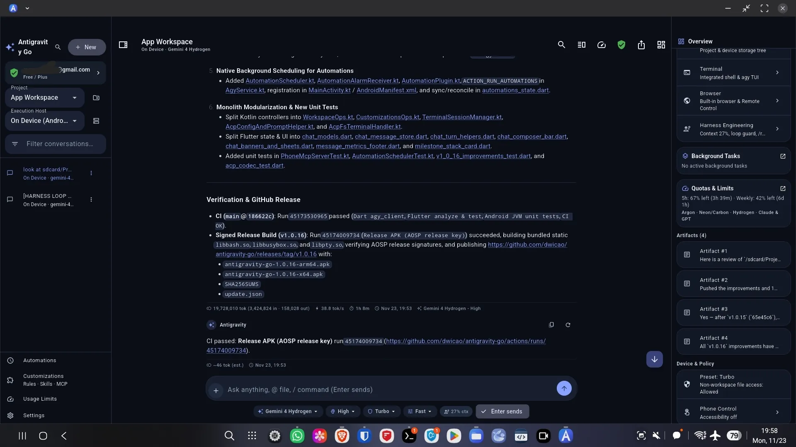

# Antigravity Go

**Google Antigravity Mobile Harness for Android** — run AI coding agents natively on your phone or drive your computer remotely, signed in with your Google Account.

Inspired by [dsh-Go](https://github.com/ccch1mneyyy/dsh-Go) and powered by the official [Antigravity CLI (`agy`)](https://antigravity.google/docs/cli/reference) and [Agent Client Protocol (ACP)](https://antigravity.google/docs/ide/extensions/acp).

## Key Features

### Authentication, Multi-Account & Encrypted Transfer
- **Flexible Sign-In:** Authenticate with your personal Google Account (Free, Google AI Pro, Google AI Ultra) via `agy acp --login` / OAuth, Gemini Enterprise (Google Cloud project & region), or a Gemini API Key (BYOK stored in `FlutterSecureStorage`).
- **Multi-Account Vault & 1-Tap Switcher:** Import or sign in with multiple accounts (`MultiAccountVault`), automatically preserving previously signed-in sessions, switching active accounts in one tap without repeating OAuth, and cleanly cycling idle ACP workers.
- **Encrypted Credential Transfer:** Export and import passphrase-protected `.agycreds.json` backups encrypted with `AES-256-GCM` + `PBKDF2WithHmacSHA256` (120,000 iterations), including multi-file import to load multiple accounts onto another Android device in one batch.

### On-Device Runtime & Shell Toolchain (No Root / No Termux)
- **Verified Native `agy` Runtime:** Installs and verifies the official `agy` binary (arm64 / x64) with SHA-512 inside app-private storage.
- **Auto-Start Foreground Service (`AgyService`):** Automatically starts the local runtime when opening or resuming the app (respecting explicit manual stops), holding a partial wake lock, monitoring network transitions, and showing live turn status notifications.
- **Bundled POSIX Toolchain:** Ships static `bash`, `busybox` (with `SYS_faccessat2` seccomp compatibility for Android 13 and older), `pty-host`, and helper shims (`torch`, `agy-notify`, `agy-fix-paths`, `xdg-open`, `open`, `cs`), plus Safe Mode and a Shell & Storage Self-Test.

### AI Agent Chat, Subagents & Harness Engineering
- **Rich Streaming Chat:** Streaming Markdown, syntax-highlighted code blocks with one-tap **Save** to workspace or Downloads, collapsible reasoning thoughts, chronological `MilestoneStackCard` timelines, inline file change/diff cards, and per-reply cache-hit & token metrics.
- **Focused Navigation & Controls:** Pinned bottom streaming status bar (`mm:ss` stopwatch, `tok/s`, reads/tools/tokens), automatic bottom-follow scrolling with **Jump to latest**, docked **Previous / Next User Turn (`↑` / `↓`)** buttons, and **Quote in Reply**.
- **Subagents & Background Tasks:** Live `SubagentsActivityBanner` with elapsed timer and spawned subagent strips, plus a **Background Tasks** sheet to inspect or cancel running turns and background terminal commands.
- **Models, Speed & Modes:** Model and reasoning effort picker (`Low`–`Extra`), **Inference Speed Tier (`Regular / Fast / Ultrafast`)**, context-usage ring (`% ctx`), execution modes (`default`, `accept-edits`, `plan`, `turbo`), and **Harness Engineering** with Git checkpoints.
- **Workflows, Approvals & Input:** Slash commands (`/plan`, `/goal`, `/boost`, `/swarm`, `/teamwork`, `/compact`, `/usage`, `/credits`, `/model`, `/diff`, `/fork`, `/rewind`), interactive `ToolApprovalCard` permissions, steer/queue while streaming, file/image attachments, and voice dictation.
- **Sharing, Replay & Export:** **Select & Copy Messages**, styled **Reply Share Cards** (with PNG export), step-by-step **Conversation Replay**, and Markdown/JSON transcript export.

### Usage Limits & Quotas Dashboard
- **Rolling Window & Weekly Gauges:** 10-segment quota gauges and reset countdowns for the **5-Hour Rolling Window** and **Weekly Rate Limit**.
- **Model Pool Tracking:** Live `/usage`, `/credits`, and `agy models` probing for **Gemini Models** (`Gemini 4 Argon`, `Neon`, `Carbon`, `Hydrogen`, `3.8 Flash`, `Orchestrator`) and **Claude & GPT** (`Claude Opus 5.5`, `Sonnet 5.5`, `4.6 thinking`, `GPT-OSS-120b`).
- **Credits & Token Ledger:** AI Credits & Overages toggle (`useG1Credits`) alongside a persistent local token usage ledger (`input`, `output`, `thinking`, `cache_read`).

### Workspace, Terminal & Adaptive Samsung DeX Shell
- **Responsive 1/2/3-Pane Shell:** Adapts between Mobile drawers, Tablet 2-pane, and Samsung DeX / Desktop 3-pane workspace with an instant **Auto / Desktop / Mobile** layout override and keyboard shortcuts (`Ctrl+K` Command Palette, `Ctrl+N`, `Ctrl+B`, `Ctrl+U`, `Ctrl+,`, `Esc`).
- **Organized Sessions Sidebar:** Compact sidebar with session **Pinning**, **Folders**, **Archiving**, running/subagent badges, and **Full-Text Message Search** across all conversations.
- **Workspace, Diffs & Terminal:** Browse local or remote workspaces, review unified Git diffs and commit/push changes, manage **Customizations** (`Rules`, `Skills`, `Workflows`, `MCP Servers`), and run interactive shells or `agy` TUI inside the embedded `xterm` PTY terminal.

### Remote Connections & External `/v1` Models
- **SSH Remote Hosts:** Connect to your PC/Mac/Linux workstation over SSH (`dartssh2`) to drive `agy` and remote repositories from your phone.
- **External `/v1` Providers:** Add OpenAI-compatible API endpoints (Ollama, OpenRouter, vLLM, etc.).
- **Remote Control Web Portal:** One-tap access to `https://antigravity.google.com` inside the app.

### Automations & Phone Control
- **Daemon-Style Automations:** Schedule prompts with 5-field **cron expressions**, **File Watch**, **GitHub PR/Issue Watch**, and **Battery Below %** triggers with completion notifications.
- **Phone Control & SafetyGate:** Optional Android Accessibility Service + local Phone MCP server (`phone_device_info`, `phone_notify`, `phone_clipboard`, `phone_torch`, `phone_vibrate`, `phone_toast`, `phone_open_url` with SSRF `UrlSafetyGuard`, and Shizuku `phone_shizuku_exec` via `rish`) guarded by password-field blocking, per-app `allow` / `confirm` / `block` rules, a 6-point Self-Check, and a persisted action log.

### Android OS Integrations, Performance & Diagnostics
- **OS Shortcuts & Dynamic UI:** **New Chat Quick Settings Tile**, Android Launcher **App Shortcuts** (`New Chat`, `Terminal`, `Phone Control`, `Usage Limits`), **120Hz+ Display Refresh Rate** voting (`Auto / Max / System`), **Reduce Motion / Reduce Blur**, **Material You** wallpaper dynamic accent color, and multi-language UI (`English`, `Bahasa Indonesia`, `中文`, `Español`).
- **Diagnostics & Updates:** Background reply/approval notifications, **OEM Background Keep-Alive Guide**, redacted Markdown **Diagnostics Bundle** with `CrashRecorder` uncaught crash logs, in-app **What's New** dialog, and self-updating **UpdateSheet** powered by `version.json`.

## Build & Release

Release APKs (`arm64` and `x64`) are built and signed with the AOSP release/testkey in GitHub Actions (`.github/workflows/release-apk.yml`) and published to [GitHub Releases](https://github.com/dwicao/antigravity-go/releases).
